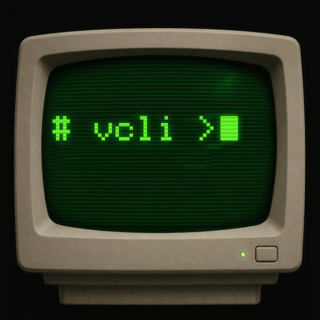
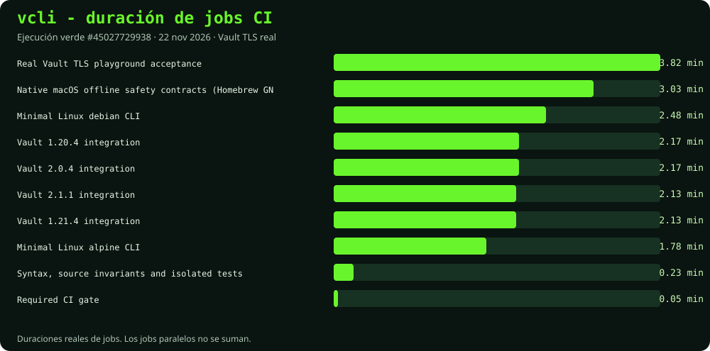
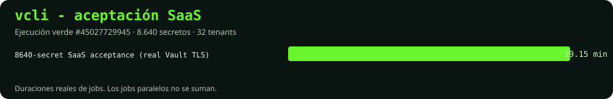
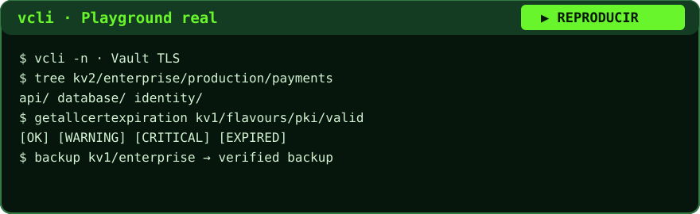
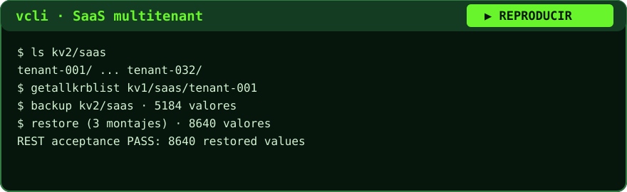

<p align="center">
  
</p>

# vcli — Bash CLI para HashiCorp Vault

**Revival en desarrollo (candidato v0.7, todavía no publicado como estable).**
CLI autocontenido en **Bash** para consultar, gestionar y explorar secretos de
HashiCorp Vault. El ejecutable modernizado es [`vcli`](vcli) y el
original histórico, conservado sin modificaciones, es
[`vcli.orig.sh`](vcli.orig.sh).

El objetivo es modernizar el CLI original, conservar las funciones útiles,
mejorar su seguridad y eficiencia y validar el comportamiento contra **Vault
real**; no sustituirlo por una implementación Python o Go.

## Funcionalidad del candidato

- Consola interactiva y modo batch (`./vcli -n`) con ayuda, historial y
  navegación/autocompletado; pruebas PTY con terminales básicos.
- KV v1 y KV v2 configurables, montajes anidados, lectura/escritura,
  listados, recorridos, operaciones compuestas y backup/restore.
  Las rutas del CLI son lógicas por defecto; `cat --api-path` y
  `ls --api-path` aceptan endpoints KV2 tipados en modo solo lectura,
  sin reinterpretar carpetas llamadas `data`, `metadata` o `delete`.
  `cat --version N` lee una versión KV2 histórica; `cat --metadata`
  inspecciona su historial y estado de borrado sin modificar secretos.
  `undelete --versions N[,N...] PATH` recupera versiones KV2 soft-deleted
  con verificación de metadata, sin afectar a las destruidas o activas.
- Autenticación mediante token o AppRole, consulta de políticas y roles,
  acceso de solo lectura y tratamiento explícito de permisos insuficientes.
- HTTPS verificado, CA personalizada, opciones de mTLS y manejo de fallos
  HTTP sin considerar seguras las escrituras ambiguas.
- Certificados X.509, claves PEM y keytabs MIT Kerberos guardados como
  secretos KV: inspección, listados y exportación protegida contra nombres
  inseguros, destinos existentes y archivos parcialmente escritos.

**Compatibilidad verificada en CI:** Vault 1.20.4, 1.21.4, 2.0.4 y 2.1.1
desde Ubuntu; los mismos **13 módulos E2E** se ejecutan en Alpine 3.22 y
Debian bookworm-slim con Vault 2.1.1. Esto **no** certifica otros entornos ni
todos los casos de uso. La PR de desarrollo sigue pendiente de auditoría final.

**macOS:** la CI ejecuta pruebas offline y los mismos **13 módulos E2E**
contra Vault 2.1.1 nativo con TLS en macOS 15; esta paridad ya está validada.
Utiliza Bash moderno y GNU coreutils de Homebrew, aunque algunas operaciones
sensibles usan `date`, `stat`, `base64`, `mktemp` o syscalls nativas BSD.
**No** se ha acreditado un runtime completamente libre de GNU.
Véase [CI/CD](docs/CI-CD.md).

## Probarlo con un Vault real, sin tocar producción

El [playground local](playground/README.md) inicia un Vault efímero con TLS
nativo y datos **sintéticos**: KV v1/v2, JSON anidado, versiones, certificados
y claves, keytabs, ejemplos inválidos, políticas y AppRoles.

Requiere Linux, Docker Compose v2, Bash, `curl`, `jq`, OpenSSL, MIT Kerberos
(`klist`) y herramientas GNU indicadas en la guía.

```bash
scripts/playground.sh up
scripts/playground.sh smoke
scripts/playground.sh shell

# O usar directamente el mismo ejecutable Bash:
source .playground/env.sh
./vcli
```

`up` repetido conserva los experimentos; `reset` los elimina y siembra
el catálogo de nuevo; `down` destruye el contenedor y las credenciales
locales. El playground se limita a loopback, no a un Vault externo.

Para batch:

```bash
printf 'cat kv1/demo/app\n' | scripts/playground.sh batch
```

## Playground SaaS a gran escala (opcional)

El perfil `saas` añade 8.640 secretos vigentes y 1.728 revisiones KV2 al
catálogo estándar. Incluye 32 tenants con ACL/AppRole propios. La misma aceptación interactiva
verifica y graba (opcionalmente) el recorrido completo: 270 hojas por tenant,
backups y restauración de 8.640 valores en prefijos aislados, y JSON de tiempos.
El catálogo original y su historial se conservan. Usa un playground recién creado.

```bash
VCLI_PLAYGROUND_PROFILE=saas scripts/playground.sh up
scripts/playground.sh shell
python3 tests/playground/test_saas.py
```

Consulta [el catálogo y las pruebas de escala](playground/README.md#perfil-adicional-saas--gran-catálogo-multi-tenant).

## Gráficas de tiempos y demos





Gráficas de **ejecuciones verificadas**, con tiempos de pared del job
(incluyendo preparación), no latencias de comandos. Los jobs de CI pueden
solaparse. Las métricas por operación del SaaS se conservan como artefacto
`vcli-saas-metrics` y se mostrarán por separado, sin mezclar medidas.

### Demos asciinema en el navegador

Toca una vista previa para abrir el **reproductor móvil**. Puedes pausar,
buscar en la línea de tiempo y elegir velocidades de 0,25× a 2×.
No requiere instalar asciinema ni descargar ZIP de Actions.

<a href="https://ml0renz0.github.io/vcli/#standard">
  
</a>

<a href="https://ml0renz0.github.io/vcli/#saas">
  
</a>

**Nota:** GitHub no permite insertar un reproductor JavaScript dentro de un
README. Estas vistas previas están integradas y abren el player interactivo
en GitHub Pages. El enlace estará activo después del primer despliegue correcto.


## Asciinema del playground actual

El job de playground de la CI genera la grabación auténtica vcli-playground.cast
como artefacto **vcli-playground-asciinema**, con retención de 7 días.
Usa Vault TLS real y datos ficticios; no publica la grabación en asciinema.org.
Una sola terminal Bash interactiva conduce las sesiones `shell readonly` y
`shell admin`, con sus correspondientes `exit` visibles. Se capturan los prompts
y respuestas reales de VCLI sin cortes ni límite de inactividad. La automatización
de teclas requiere Python 3 solo para la demo; no es un runtime de VCLI.

El recorrido de extremo a extremo cubre **todos los comandos públicos**
del ejecutable. Explora un catálogo empresarial con development, staging y
production, tres aplicaciones, credenciales compartidas, PKI con caducidades
escalonadas y keytabs sintéticos. Realiza una rotación masiva sobre una copia,
migración KV1/KV2, backup, borrado y restauración, exportación de ficheros
y verificación de permisos. La CI rechaza cualquier comando público omitido.
Los interruptores de debug se prueban sin tráfico autenticado ni volcado de secretos.

**Para grabar localmente, usa un playground recién creado, solo con datos
sintéticos.** No hagas reset automático de un laboratorio con trabajo propio.

Para reproducir: `asciinema play --speed 0.5 vcli-playground.cast`.

El [reproductor web interactivo](https://ml0renz0.github.io/vcli/) alojado
con GitHub Pages permite reproducir en el navegador los casts publicados desde
CI. Las pruebas no se ralentizan y el lector puede cambiar la velocidad.


Para regenerarla localmente:

```bash
scripts/playground.sh up
scripts/record-playground-demo.sh ./vcli-playground.cast
asciinema play ./vcli-playground.cast
scripts/playground.sh down
```

Para grabar la aceptación SaaS completa (sin ejecutar otra suite duplicada):

```bash
VCLI_PLAYGROUND_PROFILE=saas scripts/playground.sh up
VCLI_SAAS_METRICS="$PWD/vcli-saas-metrics.json" scripts/record-playground-demo.sh
asciinema play vcli-playground-saas.cast
scripts/playground.sh down
```

La grabación conserva los tiempos reales, incluidos los backups y la recuperación
integral. El artefacto de CI solo se publica si la aceptación y la verificación
de credenciales finalizan correctamente.

## Desarrollo, calidad y próximos pasos

- [Contrato CLI](docs/CLI-CONTRACT.md): comportamiento observable y garantías.
- [CI/CD y matriz de Vault real](docs/CI-CD.md): tests, limitaciones y gates.
- [Revival y secuencia de entrega](docs/REVIVAL.md): estado de la recuperación.
- [Fase 04-Q — calidad y eficiencia](docs/CODE-QUALITY.md): optimizaciones
  A/B verificadas y hallazgos de seguridad S-01–S-04 corregidos, con
  inventario de riesgos residuales. **Fase todavía abierta y previa a la
  auditoría/release v0.7**.
- [Catálogo del playground](playground/README.md): rutas, fixtures y recetas.

**Separación de alcance:** vcli OG mantiene el CLI Bash original. Los blueprints
YAML, `validate/plan/apply/drift`, políticas declarativas, plantillas SaaS
y rotación son trabajo del proyecto independiente **Secretwright**
(antiguo VCLI Forge).

## Antecedentes del proyecto

El proyecto original nació como una utilidad Bash para navegar y gestionar
Vault (en sus primeras etapas se probaba contra Vault 0.9.x). La antigua
documentación, su demostración y sus bugs históricos **no deben
interpretarse como el comportamiento del candidato actual**; el contrato
actual está en `docs/CLI-CONTRACT.md`.

[Demostración histórica (asciinema)](https://asciinema.org/a/132636)

Para comparar el original y el nuevo Bash:

```bash
git diff --no-index -- vcli.orig.sh vcli
```

El comando devuelve código 1 si encuentra diferencias.

### Contribuidores del proyecto original

- Marcos Lorenzo (creador) — [mlorenzo-stratio](https://github.com/mlorenzo-stratio)
- Ángel Prada — [angelprada](https://github.com/angelprada)
- Viktor Jacynycz — [vjacynycz-stratio](https://github.com/vjacynycz-stratio)
